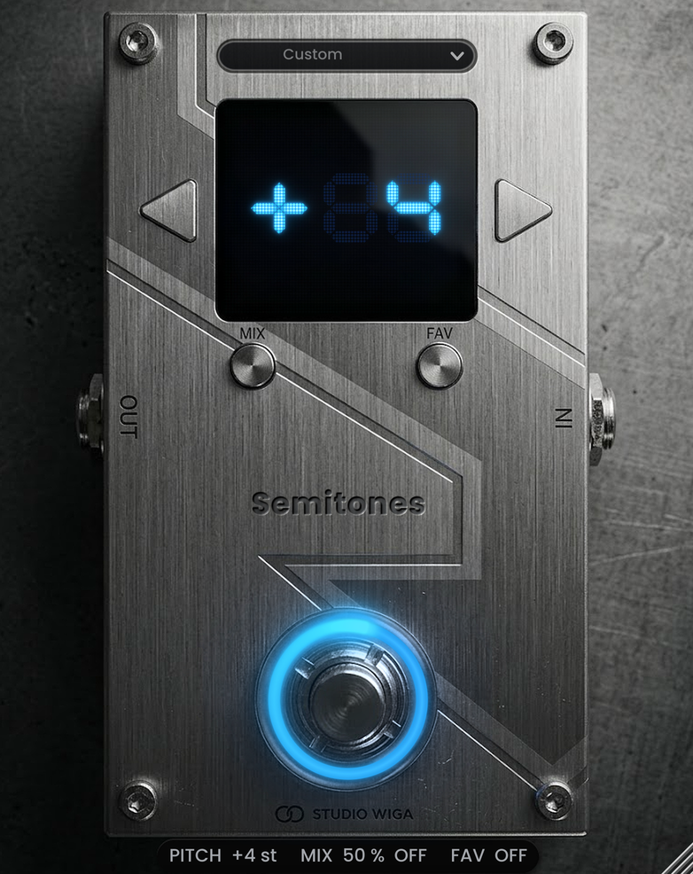

# Semitones (Studio Wiga)

Réplique VST3 de la pédale **Solar Guitars CHUG Capo** : transposition de -12 à +12 demi-tons à très faible latence (« capodastre numérique »), mode **MIX** (signal transposé + signal direct, 0 à 100 %) et mémoire **FAV**. Format pédale simple, Windows et macOS. Design Studio Wiga en acier brossé sombre sur fond béton, afficheur bleu à matrice de points, nom « Semitones » gravé, anneau lumineux bleu autour du footswitch.



- Notice EN / FR : `docs/Semitones_Manual_EN-FR_v1.1.0.pdf`
- Builds prêts à installer : onglet **Actions** > dernier run > artefacts `Semitones-VST3-Windows` / `Semitones-VST3-macOS`

## Fonctionnement (comme la pédale)

| Commande | Clic | Maintien |
|---|---|---|
| ◀ / ▶ | -1 / +1 demi-ton (répétition si maintenu) | — |
| MIX | mode MIX marche / arrêt | 0,6 s : réglage du mix aux flèches (LED et point MIX clignotent) |
| FAV | rappel / sortie de la mémoire FAV | 0,9 s : mémorise le son actuel comme FAV |
| Footswitch | effet / bypass (bascule à l'appui) | — |

Anneau bleu autour du footswitch (couleur de l'afficheur) avec une lumière à longue traînée floue et halo qui tourne (un tour en 1,6 s) : allumé = effet actif, éteint = bypass, clignotant = réglage du mix. Trait bleu au-dessus de MIX dans l'afficheur quand le mode MIX est actif ; états MIX et FAV sur la ligne d'état. Clic droit sur une commande : MIDI learn (switchs à accrochage ou momentanés, pédales d'expression lissées, CC 14 bits, course apprise). Clic droit sur le fond : taille de fenêtre (défaut 391 x 493 = minimum ; 125 %, 150 %, 200 %).

## Moteur audio

`PitchShifter.h` (indépendant de JUCE) : transposition temporelle à raccords synchronisés sur la période (corrélation normalisée, recherche grossière décimée puis fine avec interpolation), suivi de hauteur YIN jusqu'à ~31 Hz (7/8 cordes, basse), retour sur l'audio le plus récent à chaque attaque, fondus dépendant de la corrélation, adaptation automatique aux accords, anti-repliement pour les transpositions vers le haut. Retard mesuré : ~2 ms (aigus) à 6-10 ms (cordes graves), aucune latence déclarée à l'hôte. Tests : `tools/dsp_test.cpp`.

## Anti-gel v2

JUCE 8.0.15, `setOpaque`, rendu logiciel forcé sous Windows (réappliqué si le peer change), aucun calcul lourd dans `paint()`, caches reconstruits par le timer seulement, chien de garde de redessin (1,5 s), timer 30 Hz avec redessin des seules zones modifiées, jamais de `setSize` dans `resized()`, aucun appel à l'hôte depuis le thread audio (file vidée par un timer 60 Hz), paramètres lus par pointeurs atomiques.

## Construire

```
cmake -B build && cmake --build build --config Release --target Semitones_VST3
```

Visuel : `python3 -I tools/build_art.py` (génère `assets/` et `Layout.h` depuis `design/source_design.jpg`). Notice : `python3 -I tools/manual_images.py <dossier des captures>` puis `python3 -I tools/make_manual.py`. Outil Linux de captures + tests audio : `-DSEMITONES_BUILD_RENDER=ON`, cible `SemitonesRender`.

## Historique

- **1.4.1** — trait bleu au-dessus de MIX dans l'afficheur quand le mode MIX est actif (clignote pendant le réglage du mix) ; ligne d'état agrandie.
- **1.4.0** — pédale agrandie, fenêtre 391 x 493 (taille par défaut et minimum) ; menu des presets placé sur la pédale au-dessus de l'écran ; textes plus grands (menu, liste, ligne d'état) et noms de presets raccourcis ; halo du footswitch légèrement adouci.
- **1.3.1** — menu des presets fiabilisé : liste groupée (titres non sélectionnables), case jamais éditable ni prise au clavier ou à la molette, presets de l'hôte (Reaper) appliqués de façon sûre quel que soit le thread ; nom gravé réduit.
- **1.3.0** — nouveau design (acier brossé sombre sur béton, afficheur à matrice de points), nom « Semitones » gravé, indicateurs MIX / FAV retirés de l'afficheur.
- **1.2.0** — fenêtre et pédale réduites à la taille des pédales simples Studio Wiga (380 x 479 par défaut et minimum) ; anneau bleu avec lumière tournante à longue traînée.
- **1.1.0** — nouveau design acier brossé ; la LED est remplacée par un anneau lumineux bleu autour du footswitch ; build macOS sur `macos-15`.
- **1.0.0** — première version : visuel identique à la CHUG Capo + logo Studio Wiga noir, moteur faible latence, MIX, FAV, presets d'usine, MIDI learn, anti-gel v2.
